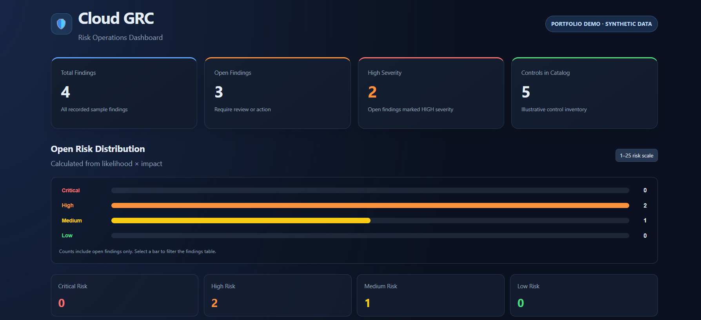
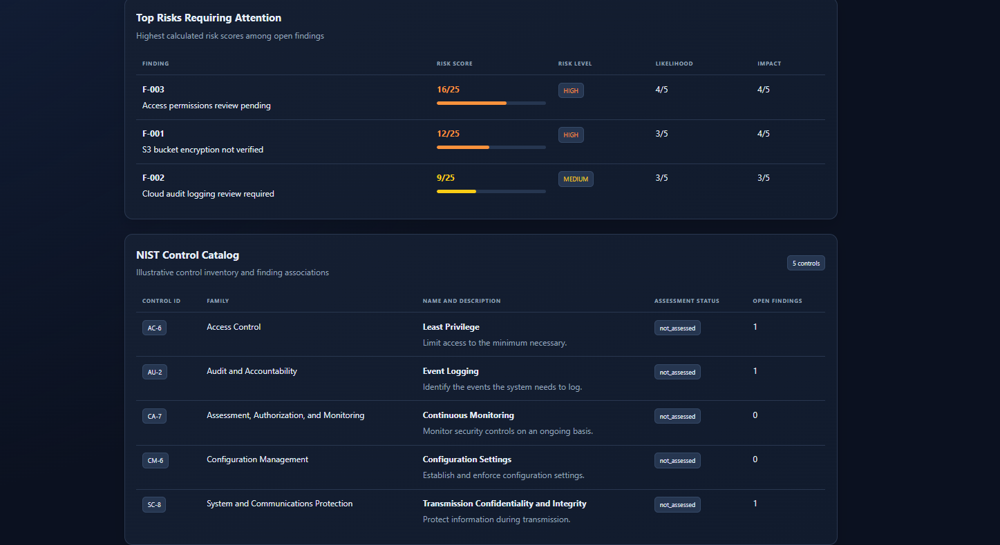
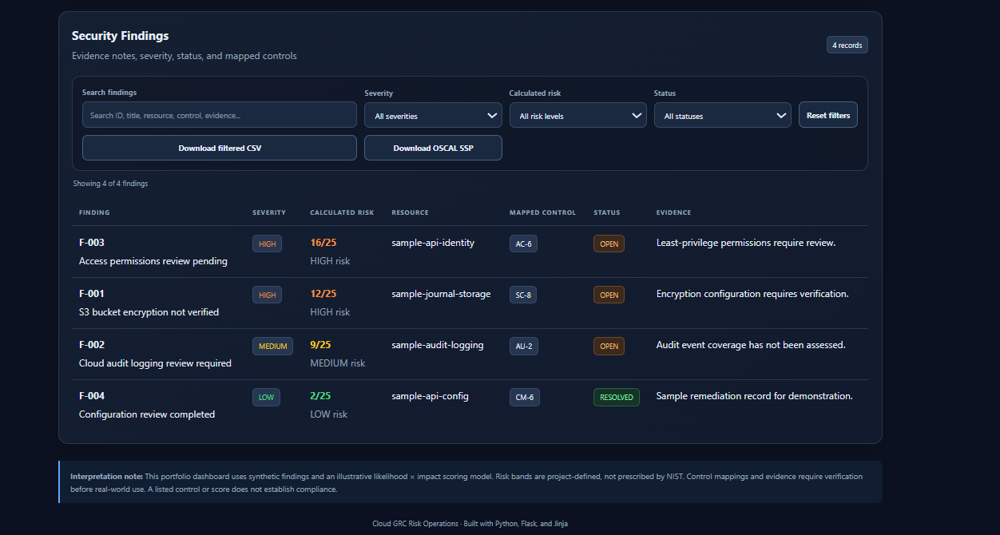

# Cloud GRC OSCAL Platform

A portfolio project demonstrating how cloud security findings can be organized, prioritized, mapped to security controls, and presented through a lightweight Governance, Risk, and Compliance (GRC) dashboard. The project also includes a downloadable example OSCAL System Security Plan (SSP).

> **Portfolio/demo project:** The included findings and resources are synthetic examples. Risk scores are illustrative, and this project does not establish or certify compliance with NIST, OSCAL, or any other framework.

## Project at a glance

- **Dashboard:** Flask application with a responsive interface for reviewing findings and security controls.
- **Risk prioritization:** Calculates an illustrative risk score from likelihood × impact and assigns a risk band.
- **Control catalog:** Displays a small example catalog of NIST SP 800-53 control identifiers and descriptions.
- **Finding review:** Supports searching and filtering findings by fields such as severity, calculated risk, and status.
- **Exports:** Download visible dashboard findings as CSV and download the example OSCAL SSP as JSON.
- **Automated tests:** Pytest coverage for the risk engine, dashboard, and OSCAL SSP download endpoint.
- **Code quality:** Ruff lint checks.

## Why this project

GRC work often involves turning technical observations into trackable risks, connecting those risks to control objectives, and making the current state understandable to technical and non-technical stakeholders. This project explores that workflow in a small, inspectable application.

It is intended to demonstrate practical skills in Python, Flask, test-driven verification, risk tracking, control mapping, and structured security documentation.

## Features

### Risk dashboard

The dashboard summarizes open findings, shows severity and calculated-risk distributions, highlights high-priority items, and groups findings by control. Search and filters help narrow the displayed findings. CSV export downloads the currently visible findings.

### Illustrative risk scoring

The risk engine multiplies likelihood by impact and maps the result to a demonstration band:

| Score | Illustrative band |
| ---: | --- |
| 1–4 | Low |
| 5–9 | Medium |
| 10–16 | High |
| 17–25 | Critical |

These thresholds are project-specific examples, **not** scores or thresholds prescribed by NIST. A real implementation should document its methodology, define risk acceptance criteria, and validate scores with the organization’s risk owners.

### Control catalog and findings

The example catalog includes a small set of NIST SP 800-53 control identifiers, such as AC-6, AU-2, CA-7, CM-6, and SC-8. The sample findings are synthetic and demonstrate how a finding can reference a control, resource label, status, evidence note, likelihood, and impact.

A control reference in this demo is a starting point for review, not proof that a finding is correctly mapped or that a control has been assessed.

### OSCAL SSP export

The application provides a download endpoint for the example System Security Plan:

- Dashboard: `/`
- OSCAL SSP JSON download: `/exports/oscal-ssp`

The exported file is an example artifact for portfolio demonstration. Successful JSON parsing or a successful download does not, by itself, prove that the SSP conforms to the OSCAL schema or that the described system meets any security requirements.

## Architecture

```text
Browser
   |
   v
Flask application
   |-- Dashboard routes and HTML template
   |-- Risk-prioritization engine
   |-- Example control catalog
   |-- Synthetic findings in JSON
   |-- OSCAL SSP JSON download
   |
   v
Pytest tests + Ruff lint checks
```

## Repository layout

```text
app/
  __init__.py                  Flask application factory
  routes.py                    Dashboard and export routes
  controls.py                  Example control catalog
  risk_engine.py               Illustrative risk prioritization
  templates/dashboard.html     Dashboard interface
data/
  sample_findings.json         Synthetic sample findings
oscal/
  generate_ssp.py              SSP generation script
  ssp.json                     Example SSP JSON artifact
system-security-plans/
  cloud-journal-api/
    system-security-plan.json  Example SSP used by the download route
tests/
  test_dashboard.py            Dashboard and export endpoint tests
  test_risk_engine.py          Risk engine tests
requirements.txt               Python dependencies
scripts/
  validate_project.sh          Project validation helper
```

## Run locally

### Requirements

- Python installed
- Git
- A terminal in the repository directory

### Setup

```bash
git clone https://github.com/shassanahmed93-rgb/cloud-grc-oscal-platform.git
cd cloud-grc-oscal-platform

python -m venv .venv
source .venv/bin/activate        # Linux / macOS / WSL
# Windows PowerShell: .venv\Scripts\Activate.ps1

python -m pip install --upgrade pip
python -m pip install -r requirements.txt
```

### Start the dashboard

```bash
python -m flask --app app run --debug
```

Open <http://127.0.0.1:5000> in your browser.

### Run tests and lint checks

```bash
python -m pytest -q
python -m ruff check app tests
```

The project was last checked locally with **19 tests passing** and **Ruff reporting “All checks passed!”**. This records a local verification result, not a claim that a hosted CI workflow has run.

## Current scope and limitations

- Uses synthetic sample findings, not live production evidence.
- Does not connect to AWS or collect cloud evidence automatically.
- Does not perform a formal audit or determine compliance.
- Risk scoring is illustrative and should not be treated as a validated enterprise methodology.
- The example SSP download is JSON; schema conformance must be validated separately.
- Control mappings and evidence statements require human review before use in a real environment.

## Possible next steps

- Add GitHub Actions to run pytest and Ruff on every pull request and push.
- Add explicit OSCAL schema validation to the test or validation workflow.
- Improve control-mapping rationale and evidence traceability.
- Add a documented risk methodology and configurable risk acceptance criteria.
- If adding AWS evidence collection, use least-privilege, read-only permissions and clearly distinguish observed evidence from inferred status.

## Security and responsible use

Do not add credentials, access keys, real customer data, or sensitive production evidence to this repository. Use synthetic or sanitized examples for portfolio demonstrations. Before using a similar workflow in an organization, review its security, access controls, data handling, risk methodology, and control mappings.

## Author

Built as a hands-on portfolio project focused on cloud GRC, risk prioritization, security controls, Python, Flask, and OSCAL-style security documentation.

- GitHub: <https://github.com/shassanahmed93-rgb>

## 📸 Dashboard Preview

The Cloud GRC platform provides an interactive view of synthetic security findings, risk prioritization, and control mappings. The data is for demonstration purposes and does not represent verified production compliance evidence.

### Risk Dashboard



### Findings and Control Catalog



### Additional Findings View



